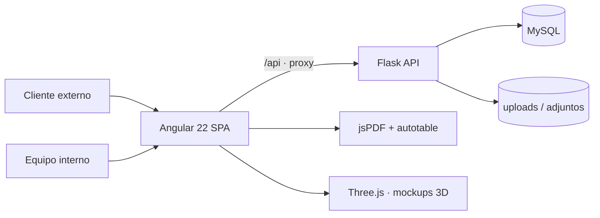

# Documentación funcional y técnica — Llamma

**Fecha:** 26 de noviembre de 2026  
**Alcance:** portal público, ERP interno, API, base de datos, reglas de negocio, seguridad y pruebas.  
**Fuente:** código del repositorio (`src/`, `Flask_Llamma_API/`, `e2e/`) y pruebas ejecutadas en local.

---

## Índice

1. [Visión general](#1-visión-general)
2. [Lenguajes y tecnologías](#2-lenguajes-y-tecnologías)
3. [Arquitectura](#3-arquitectura)
4. [Rutas y control de acceso](#4-rutas-y-control-de-acceso)
5. [Portal público](#5-portal-público)
6. [ERP interno](#6-erp-interno)
7. [Reglas de negocio](#7-reglas-de-negocio)
8. [Estados del sistema](#8-estados-del-sistema)
9. [Modelo de datos](#9-modelo-de-datos)
10. [API](#10-api)
11. [Seguridad y configuración](#11-seguridad-y-configuración)
12. [Base de datos y migraciones](#12-base-de-datos-y-migraciones)
13. [Calidad y pruebas](#13-calidad-y-pruebas)
14. [Puesta en marcha](#14-puesta-en-marcha)
15. [Limitaciones y deuda técnica conocida](#15-limitaciones-y-deuda-técnica-conocida)
16. [Mapa de archivos](#16-mapa-de-archivos)
17. [Glosario](#17-glosario)

---

## 1. Visión general

Llamma es un sistema web para una imprenta y empresa de transformación de productos. Tiene dos experiencias en una misma SPA:

- **Portal público:** landing, catálogo, solicitud de cotización, comprobante PDF, seguimiento por folio y chat con el equipo.
- **ERP interno:** panel autenticado con roles para atender solicitudes, cotizar, convertir pedidos, controlar inventario, comprar insumos, producir, consultar ventas y administrar usuarios.

La API Flask concentra la lógica y la persistencia; Angular consume `/api` mediante el proxy de desarrollo.



---

## 2. Lenguajes y tecnologías

### Frontend

| Tecnología                                  | Uso                                                                                    |
| ------------------------------------------- | -------------------------------------------------------------------------------------- |
| **TypeScript ~6.0**                         | Componentes, servicios, modelos, guards e interceptores.                               |
| **Angular 22.2**                            | Standalone components, signals, `@if`/`@for`, Reactive Forms, Router con lazy loading. |
| **HTML5**                                   | Plantillas de componentes.                                                             |
| **CSS + Tailwind CSS 4.3**                  | Sistema visual; Flowbite 4 como plugin. Bootstrap ya no se usa.                        |
| **Bootstrap Icons 1.11**                    | Solo glifos `bi-*`.                                                                    |
| **RxJS 7.8**                                | HTTP, `forkJoin`, `finalize`, `shareReplay`.                                           |
| **jsPDF 4 + jspdf-autotable 5**             | Comprobante de solicitud en PDF vectorial A4.                                          |
| **Three.js 0.187**                          | Previsualizador 3D con modelos GLB.                                                    |
| **Vitest 4 + jsdom**                        | Pruebas unitarias.                                                                     |
| **Playwright 1.65**                         | Pruebas E2E en Chromium, Firefox, WebKit y Mobile Chrome.                              |
| **ESLint 10 + angular-eslint + Prettier 3** | Lint y formato.                                                                        |

### Backend

| Tecnología               | Uso                                               |
| ------------------------ | ------------------------------------------------- |
| **Python 3.13**          | Lenguaje de la API.                               |
| **Flask 3.1**            | Framework HTTP y blueprints por dominio.          |
| **Flask-SQLAlchemy 3.1** | ORM sobre MySQL/SQLite.                           |
| **Flask-Cors 6**         | Orígenes permitidos del frontend.                 |
| **PyMySQL 1.1**          | Driver MySQL.                                     |
| **Werkzeug**             | Hash de contraseñas (`scrypt`) y seguridad.       |
| **Pillow 11**            | Preparación/optimización de imágenes de mockups.  |
| **unittest**             | Pruebas de flujo del backend con SQLite temporal. |

### Datos e infraestructura

- **MySQL 8** (Laragon en local) con `utf8mb4_unicode_ci`.
- **SQLite** para pruebas backend/E2E y desarrollo alternativo.
- **Vite/Angular CLI** como dev server y build.
- **GitHub Actions** para formato, lint, pruebas y build.

---

## 3. Arquitectura

### Capas del frontend

```text
src/app/
├── core/        servicios singleton, modelos, guards, interceptores, configuración
├── shared/      UI reutilizable (diálogo de confirmación, directiva de modales)
└── features/    un directorio por dominio funcional
```

Convenciones:

- Componentes **standalone**, `ChangeDetectionStrategy.OnPush`, `inject()` y signals.
- Formularios con **Reactive Forms** y validaciones espejo de la API.
- Estado local con signals; sin store global salvo sesión (`AuthService`).
- Los datos siempre pasan por `LlammaService` (HttpClient); no hay mocks en producción.
- Los toasts y confirmaciones viven en `UiService` y `ConfirmacionService`.
- Modales accesibles con `appModalAccesible` (foco atrapado, `Esc`, `aria-labelledby`, bloqueo de scroll).

### Capas del backend

```text
Flask_Llamma_API/
├── app.py            fábrica, CORS, cabeceras, errores globales
├── config.py         entorno, BD, límites, festivos
├── auth.py           tokens, sesiones y decoradores de rol
├── ratelimit.py      límites en memoria por IP/cuenta
├── estados.py        catálogo único de estados
├── produccion_config.py  pasos por producto/línea
├── models/           27 tablas por dominio
├── routes/           un blueprint por dominio
├── migrations/       scripts idempotentes de esquema/datos
└── tests/            pruebas de flujo con unittest + SQLite
```

- Los imports son planos (`from models import ...`); la API debe ejecutarse desde `Flask_Llamma_API/`.
- `routes/admin_routes.py` reúne los blueprints internos; las rutas públicas viven aparte.
- Serialización con `to_dict()` en **camelCase** y tipos espejo en `src/app/core/models/llamma.models.ts`.
- Listados devuelven `{ items, total }`; el detalle de pedido se consulta aparte.

---

## 4. Rutas y control de acceso

### Portal público (sin sesión)

| Ruta                | Función                                                                  |
| ------------------- | ------------------------------------------------------------------------ |
| `/`                 | Landing corporativa, propuesta de valor, productos destacados y proceso. |
| `/productos`        | Catálogo activo/publicado, búsqueda y filtros por línea.                 |
| `/cotizar`          | Solicitud de cotización en 3 pasos, adjuntos, mockups y comprobante.     |
| `/seguimiento`      | Consulta por folio + correo, estatus, adjuntos y chat.                   |
| `/aviso-privacidad` | Aviso LFPDPPP y contacto del responsable.                                |
| `/login`            | Acceso del equipo; `publicOnlyGuard` evita entrar si ya hay sesión.      |

### ERP interno (protegido)

| Ruta              | Roles permitidos                       |
| ----------------- | -------------------------------------- |
| `/dashboard`      | Todos los autenticados.                |
| `/solicitudes`    | admin, ventas, producción.             |
| `/captura`        | admin, ventas.                         |
| `/detalle`        | admin, ventas, producción.             |
| `/consultas`      | admin, ventas, producción.             |
| `/inventario`     | admin, ventas, inventario, producción. |
| `/abastecimiento` | admin, ventas, inventario, producción. |
| `/produccion`     | admin, ventas, inventario, producción. |
| `/clientes`       | admin, ventas.                         |
| `/usuarios`       | solo admin.                            |
| `/marketing`      | solo admin (legado).                   |
| `/**`             | Página 404.                            |

Además de los guards de ruta, la API aplica `@token_required` y `@role_required(...)`. Ocultar un botón no sustituye la validación del backend.

### Matriz funcional por rol

| Rol            | Puede editar                                 | Solo lectura / acceso                                              |
| -------------- | -------------------------------------------- | ------------------------------------------------------------------ |
| **Admin**      | Todo                                         | Todo.                                                              |
| **Ventas**     | Ventas, clientes, cotizaciones, solicitudes. | Inventario, producción y abastecimiento (sin acciones de gestión). |
| **Producción** | Producción e inventario.                     | Ventas, solicitudes, consultas, detalle.                           |
| **Inventario** | Inventario y abastecimiento.                 | Producción. Sin acceso a ventas/clientes/consultas.                |
| **Marketing**  | Sin módulos operativos.                      | Dashboard; `/marketing` queda como legado solo para admin.         |

Las pantallas de solo lectura muestran el badge `modo-lectura` y ocultan botones de gestión.

---

## 5. Portal público

### 5.1 Inicio (`/`)

- Hero con llamados a cotizar y ver catálogo.
- Vitrina «Nuestros productos» (`#nuestros-productos`) con casos de portafolio en WebP.
- Secciones de materias primas/proceso cargadas con `@defer (on viewport)` para no inflar el chunk inicial.
- Datos de contacto desde `src/app/core/config/site-info.ts`; los campos vacíos no se muestran.
- SEO por ruta con `SeoService` (título, descripción, canonical, OG/Twitter, JSON-LD).

### 5.2 Catálogo (`/productos`)

- Lista productos **activos y publicados**; los borradores solo se ven en la gestión interna.
- Búsqueda por nombre/descripción/línea y filtro por línea de producción.
- Precio base de referencia, unidad de venta e imagen (`productos.imagen_url`).
- Si la imagen falla, la tarjeta vuelve al icono; la imagen debe ser local o del mismo dominio por CSP.
- Productos demo del catálogo: Roll-up premium 85 × 200 cm, Lona/Vinil, Playera DTF 29 × 29 cm, Playera DTF menor a 29 × 29 cm, Tote bag de manta, Taza cerámica sublimada, Sticker troquelado y Tarjetas Couché 300g.
- La primera imagen se carga con prioridad (`eager` + `fetchpriority=high`); el resto en `lazy`.
- Las tarjetas del inicio enlazan a `/productos?linea=gran-formato|textil|promocionales|papeleria`;
  el catálogo aplica el filtro desde la URL, normaliza alias/tildes y sincroniza los cambios manuales
  con el historial. `Todas las líneas` elimina el parámetro.
- El catálogo se cachea con `shareReplay` y se invalida al mutar productos desde el ERP.

### 5.3 Cotizador público (`/cotizar`)

Flujo en 3 pasos:

1. **Contacto:** nombre, empresa, correo, teléfono, segmento y método de entrega.
2. **Productos:** selección del catálogo, cantidad, medidas (ancho × largo en m²), material Lona/Vinil y especificaciones.
3. **Proyecto:** mensaje, fecha deseada y adjuntos.

Características:

- **Carrito de partidas** con estimado por línea y total con IVA (16%).
- **Lona/Vinil:** selector de material y cálculo por m²:
  - Lona: `$220` por el primer m² + `$120` por m² adicional.
  - Vinil: `$180` por el primer m² + `$90` por m² adicional.
- **Productos por pieza:** precio base × cantidad.
- **Mayoreo:** desde **6 unidades** se descuentan **$20 por unidad**. El descuento se calcula sobre
  el promedio unitario (también aplica a m²), se redondea a centavos y no se aplica si el unitario
  es `<= $20` para evitar importes en cero o negativos. El resumen muestra «Subtotal sin mayoreo»,
  «Descuento mayoreo (6+)» y el total; el comprobante lo refleja en pantalla y en el PDF.
- **Fecha de entrega:** mínimo 2 días hábiles; la regla vive en `utils.calcular_fecha_minima_entrega()` y `src/app/core/utils/fechas.ts`, con festivos en `config.DIAS_FESTIVOS` y `src/app/core/config/dias-festivos.ts`.
- **Adjuntos:** PDF, AI, PSD, PNG, JPG, JPEG, SVG y ZIP, con límite de 25 MB; los archivos no se guardan en el borrador.
- **Validación de envío:** se exige al menos una partida con cantidad e importe mayores a cero.
  No se permiten solicitudes solo con mensaje, solo con archivos ni con totales en `$0.00`; el
  botón se deshabilita y la API responde `400` (`sin_partidas`, `cantidad_invalida`,
  `precio_invalido`).
- Los adjuntos de imagen muestran una **miniatura real** en el Paso 3, con nombre, tamaño y botón
  para quitarlos; las capturas 2D/3D también aparecen como miniatura y reemplazan la anterior si
  se vuelve a capturar la misma vista.
- **Borrador:** `localStorage` (`llamma.cotizacion.borrador.v1`) durante 30 días; al recuperarlo se piden de nuevo los archivos.
- **Previsualizador 2D:** el cliente sube su diseño, elige una vista del producto, ajusta encuadre/escala/posición y adjunta una captura compuesta.
- **Previsualizador 3D:** modelos GLB con Three.js; permite subir capas, moverlas, escalar, rotar y capturar la escena. Si el GLB falla, cae a un modelo procedural con aviso «Vista aproximada».
- **Comprobante PDF:** se genera bajo demanda con jsPDF + autotable, sin `window.print()`.
  - A4 vectorial, logo, folio, datos del cliente, partidas, resumen, mensaje y condiciones.
  - El resumen separa subtotal sin mayoreo, descuento de mayoreo (6+), subtotal con mayoreo, IVA y total.
  - Tablas largas paginan solas; cada página lleva pie y número.
  - **Incluye las capturas 2D/3D del previsualizador** en la sección «Diseño del cliente», con vista, producto, material, medidas y capas. Las imágenes se leen con `FileReader`, se reescalan a JPEG (máx. 1400 px) y se incrustan; no dependen de CORS ni de URLs `blob:`.
  - Archivo: `Comprobante_<folio>_Llamma.pdf`.

### 5.4 Seguimiento (`/seguimiento`)

- Acceso con **folio + correo exactos** (sin cuenta).
- Muestra estado, fecha, partidas, totales y mensaje del proyecto.
- **Entrega confirmada:** cuando la solicitud ya es pedido, muestra la fecha comprometida por el
  equipo, la fecha deseada original, quién/cuándo la confirmó, la nota pública de logística y el
  pedido (`LLM-...`).
- **Proceso actual:** estado del pedido, etapa de producción en curso y línea de tiempo de las
  etapas (`pendiente`, `en-proceso`, `completada`, etc.).
- Botón «Actualizar estado» para refrescar sin recargar la página.
- Descarga de adjuntos con autorización por folio/correo.
- **Chat por solicitud:** historial, mensajes y archivos, con límites de frecuencia.
- Acepta `?folio=...&correo=...` para abrir el resultado directo.

### 5.5 Aviso de privacidad

Texto base LFPDPPP, finalidades, derechos ARCO y contacto. Debe revisarse con asesoría legal antes de publicar.

---

## 6. ERP interno

### 6.1 Dashboard

- KPIs de ventas del periodo, ticket promedio y órdenes en producción.
- Ventas por línea de negocio y estado de producción.
- Órdenes recientes y alertas de inventario bajo.
- Contador de solicitudes nuevas en la barra interna.

### 6.2 Solicitudes (`/solicitudes`)

- Bandeja de solicitudes entrantes con filtros por estado y búsqueda.
- Detalle del cliente, partidas, mensaje, fecha deseada y método de entrega.
- Descarga de adjuntos y tarjeta «Previsualización del diseño» para capturas 2D/3D.
- Cambio de estado (`nueva`, `en-revision`, `cotizada`, `convertida`, `descartada`).
- **Producción vinculada:** cuando la solicitud ya tiene pedido, la tarjeta y el detalle muestran
  `Pedido LLM-...`, estado del pedido, etapa/estado de producción y un badge
  `Producción completada`. La solicitud conserva `Convertida` como estado histórico.
- **Entrega:** el botón `Marcar entregado` del bloque `PEDIDO / PRODUCCIÓN` registra que el cliente
  ya recogió/recibió el pedido. Solo se habilita cuando el pedido está `Listo`; después muestra
  `Entregado` y conserva `Producción: Completada`. La acción pide confirmación y persiste en el
  pedido.
- Contadores `En producción`, `Producción completada` (con subtotal `N entregados`) y filtros
  `En producción`, `Producción completada`, `Entregados`.
- Chat interno con el cliente y adjuntos.
- Conversión de la solicitud en cotización.
- Acciones rápidas: copiar correo, abrir WhatsApp.

### 6.3 Captura / cotizador interno (`/captura`)

- Alta de cotización desde cero o revisión de una cotización existente.
- Datos del cliente, partidas, precios, IVA y condiciones.
- Guardado en estado borrador o envío.
- **Aprobación:** descuenta inventario según la receta de cada producto; si falta stock, responde `400` con `InventarioInsuficiente` y detalles. La bandera `inventario_descontado` evita el doble descuento.
- **Conversión a pedido:** crea el pedido y su orden de producción. La fecha se precarga con la
  deseada por el cliente y el equipo la confirma o ajusta antes de convertir.
- **Mayoreo en cotizaciones:** las partidas capturadas a mano también aplican $20 menos por unidad
  desde 6 unidades. Al convertir una solicitud, el importe estimado ya incluye el mayoreo y se
  conserva sin volver a descontarlo.
- Registro de anticipo/abono/liquidación y cálculo de saldo.
- Resumen de cotización con IVA, anticipo del 50% y condiciones.

### 6.4 Detalle de órdenes (`/detalle`)

- Vista de pedido con folio, cliente, partidas y totales.
- Paneles plegables (divulgación progresiva): producción, calidad, pagos, entrega y archivos.
- Historial de etapas, etapa actual, estado, prioridad y checklist de calidad.
- **Entrega:** `admin`/`ventas` confirman o reprograman la fecha comprometida, con nota pública
  opcional; se guarda quién y cuándo la confirmó. El cliente ve ese cambio en `/seguimiento`.
- Impresión del detalle: abre los paneles antes de imprimir y restaura la preferencia.
- Apertura/descarga de los archivos del pedido.
- **Pagos:** el anticipo del 50% es una referencia; “Pagado” suma solo pagos confirmados y
  `saldo = total - pagado`. “Liquidación” autocompleta el saldo exacto con centavos y “Abono”
  permite cualquier monto positivo que no exceda el saldo.

### 6.5 Consultas (`/consultas`)

- Constructor de consultas por rango de fechas, estado, línea de negocio, cliente y texto.
- Consultas guardadas y exportación de resultados.
- Resumen del periodo: pedidos, monto, ticket promedio y entregados.
- Composición de ventas por línea y ranking de clientes.
- Los filtros se envían a la API y respetan la fecha local del negocio.

### 6.6 Inventario (`/inventario`)

Dos vistas:

- **Por producto (default):** tarjetas con la receta de cada producto, insumos, stock actual y alerta de bajo stock; botón «Reponer».
- **Tabla general:** existencias, mínimos/máximos, nivel, costo, estado y acciones.
- Filtros por texto, categoría y estado (ver limitaciones).
- Registro de **movimientos**: entrada, salida, ajuste, merma y devolución, con motivo/referencia y trazabilidad de usuario.
- Alta/edición/baja lógica de materias primas.
- Exportación de la tabla.
- Sugerencias de compra según stock mínimo/máximo.

### 6.7 Abastecimiento (`/abastecimiento`)

- Órdenes de compra con folio, proveedor, partidas, totales y estado.
- Filtros por texto/estado (ver limitaciones).
- Proveedores estratégicos y directorio.
- Reposición sugerida y compras recomendadas.
- Calendario de recepciones.
- Alta de orden de compra.
- Al pasar una OC a `recibida`, la API suma stock y crea un movimiento de inventario tipo `entrada`; no se debe duplicar a mano.

### 6.8 Producción (`/produccion`)

- Tablero kanban por etapas, con carga por etapa y últimos controles.
- Los pasos son **dinámicos según el producto**:
  - Lona/Vinil, stickers y tarjetas: Diseño → Impresión → Corte → Empaquetado.
  - Playera, taza y tote bag: Diseño → Impresión → Plasmado → Empaquetado.
  - Roll-up: Diseño → Impresión → Empaquetado.
- Los pedidos nuevos reciben todas sus `ProduccionEtapa`; los pedidos antiguos conservan su historial de 8 etapas.
- Abrir orden, avanzar/regresar etapa, editar estado/prioridad y observaciones.
- Checklist de calidad y reporte de turno exportable.
- El backend valida que el avance use una etapa planificada del producto.
- **Cierre:** `Completar orden` o `Estado=Completada` solo procede en la última etapa y con las
  anteriores completadas. Marca todas las etapas como completadas, deja el pedido `listo` y retira
  la orden del tablero operativo. El resultado se ve en `/solicitudes` como
  `Producción completada` (sin perder `Convertida`) y en `/detalle?pedido=...`.
- **Entrega:** es un paso distinto de producción. Se registra desde `/solicitudes` con
  `Marcar entregado` cuando el pedido está `Listo`; el pedido pasa a `entregado` y el badge cambia a
  `Entregado` sin borrar el estado `Producción: Completada`.

### 6.9 Clientes (`/clientes`)

- Directorio con búsqueda por nombre, empresa o RFC, y filtros por segmento/estado.
- Alta y edición de datos fiscales/contacto.
- Expediente con notas fechadas y autor.
- Segmentos (particular, PyME, corporativo, escolar, gobierno, eventos, otro).
- Exportación del directorio.
- Baja lógica (solo admin).

### 6.10 Usuarios (`/usuarios`)

Solo admin.

- Listado de cuentas con rol, estado y último acceso.
- Alta con nombre, correo, contraseña y rol.
- Edición de nombre/correo/rol; la contraseña es opcional.
- Validaciones: nombre 2–120, correo válido ≤160, contraseña 8–128; correo duplicado `409`; rol inexistente `400`.
- Indicador de fuerza de contraseña.
- Al cambiar la contraseña se revocan las sesiones abiertas del usuario.
- Roles disponibles: admin, ventas, producción, inventario y marketing (este último sin módulos en el frontend).

### 6.11 Marketing (`/marketing`, legado)

- Campañas, desempeño por campaña/canal, mezcla de medios, calendario de actividades y presupuesto.
- Ruta visible solo para admin; Marketing no tiene acceso al ERP en el menú.

### 6.12 Página 404

- Cualquier ruta desconocida muestra «Esta página no existe.» con buscador y enlaces a inicio, catálogo, cotizador y seguimiento.

---

## 7. Reglas de negocio

1. **IVA:** 16% sobre el subtotal; los totales se redondean a 2 decimales.
2. **Precios de catálogo:** son referenciales y pueden ajustarse en la cotización formal.
3. **Lona/Vinil:** base + adicional por m² (ver fórmulas en 5.3).
4. **Entrega:** mínimo 2 días hábiles; se valida en frontend y backend, con festivos configurables.
5. **Inventario:** se descuenta al aprobar la cotización o al convertirla en pedido, una sola vez (`inventario_descontado`). La validación es atómica: si falta cualquier insumo, no se toca la base.
6. **Recetas:** cada producto puede tener componentes (materia prima, cantidad, unidad, desperdicio, rendimiento).
7. **Compras:** una OC `recibida` incrementa stock y registra movimiento de entrada.
8. **Pedidos:** estados `cotizacion`, `confirmado`, `en-produccion`, `listo`, `entregado`, `cancelado`.
9. **Pagos:** anticipo, abono o liquidación; solo los pagos confirmados reducen el saldo (`saldo = total - pagos confirmados`). El anticipo del 50% es una referencia y no se descuenta hasta registrarse como pago; el saldo se recalcula y se refleja en el detalle.
10. **Producción:** pasos por producto/línea; los pedidos históricos no se reescriben.
11. **Chat público:** solo con folio + correo; límites por folio/IP.
12. **Fechas de negocio:** `Pedido.fecha_pedido` y `Cotizacion.fecha_emision` usan `date.today()` local para que los filtros «hasta hoy» incluyan el día en curso.

---

## 8. Estados del sistema

Catálogo único en `Flask_Llamma_API/estados.py` y `src/app/core/models/estados.ts`.

| Dominio    | Valores                                                                                                             |
| ---------- | ------------------------------------------------------------------------------------------------------------------- |
| Solicitud  | `nueva`, `en-revision`, `cotizada`, `convertida`, `descartada`                                                      |
| Cotización | `borrador`, `enviada`, `aprobada`, `rechazada`, `vencida`, `convertida`                                             |
| Pedido     | `cotizacion`, `confirmado`, `en-produccion`, `listo`, `entregado`, `cancelado`                                      |
| Producción | `pendiente`, `en-proceso`, `pausada`, `completada`, `rechazada`                                                     |
| Compra     | `pendiente`, `confirmada`, `en-transito`, `recibida`, `cancelada`                                                   |
| Movimiento | `entrada`, `salida`, `ajuste`, `merma`, `devolucion`                                                                |
| Canal      | `redes-sociales`, `google-ads`, `correo`, `punto-de-venta`, `referidos`, `otro`                                     |
| Etapas     | `diseno`, `impresion`, `laminado`, `corte`, `plasmado`, `confeccion`, `armado`, `acabado`, `empaquetado`, `entrega` |

Un estado nuevo exige tocar el backend, la unión de tipos de `llamma.models.ts` y el catálogo de `estados.ts`.

---

## 9. Modelo de datos

**27 tablas** agrupadas por dominio (`models/`):

| Dominio        | Tablas                                                                             |
| -------------- | ---------------------------------------------------------------------------------- |
| Seguridad/RBAC | `roles`, `permisos`, `rol_permisos`, `usuarios`, `sesiones_usuario`                |
| Catálogo       | `clientes`, `productos`, `recetas`, `receta_componentes`                           |
| Inventario     | `proveedores`, `materias_primas`, `movimientos_inventario`                         |
| Compras        | `ordenes_compra`, `ordenes_compra_items`                                           |
| Solicitudes    | `solicitudes_cotizacion`, `solicitud_items`, `solicitud_archivos`, `mensajes_chat` |
| Ventas         | `cotizaciones`, `cotizacion_items`, `pedidos`, `pedido_items`, `pagos`             |
| Producción     | `ordenes_produccion`, `produccion_etapas`, `controles_calidad`                     |
| Marketing      | `actividades_marketing`                                                            |

Relaciones principales:

- `SolicitudCotizacion` → items, archivos y mensajes.
- `Cotizacion` → items → `Pedido` → items y pagos.
- `Pedido` → `OrdenProduccion` → `ProduccionEtapa` + `ControlCalidad`.
- `Producto` → `Receta` → `RecetaComponente` → `MateriaPrima`.
- `MateriaPrima` → `MovimientoInventario` (usuario responsable).
- `Usuario` → `SesionUsuario` (token hasheado).

---

## 10. API

Prefijo `/api`. Respuestas de error: `{ error, codigo }`; listados: `{ items, total }`. Token en `Authorization: Bearer` o `X-Auth-Token`.

### Autenticación

| Método | Ruta                         |
| ------ | ---------------------------- |
| POST   | `/api/auth/login`            |
| GET    | `/api/auth/me`               |
| POST   | `/api/auth/logout`           |
| GET    | `/api/auth/sesiones` (admin) |

### Público

| Método   | Ruta                                                    |
| -------- | ------------------------------------------------------- |
| GET      | `/api/health`                                           |
| GET      | `/api/public/productos`                                 |
| GET      | `/api/public/productos/<id>`                            |
| GET      | `/api/public/opciones`                                  |
| POST     | `/api/public/solicitudes`                               |
| GET      | `/api/public/solicitudes/<folio>?correo=`               |
| GET/POST | `/api/public/solicitudes/<folio>/mensajes`              |
| GET      | `/api/public/solicitudes/<folio>/mensajes/<id>/archivo` |
| POST     | `/api/public/mockups/preparar-imagen`                   |

### ERP

| Dominio      | Endpoints principales                                                                                                                    |
| ------------ | ---------------------------------------------------------------------------------------------------------------------------------------- |
| Solicitudes  | `GET/POST /solicitudes`, `GET /solicitudes/<id>`, `PATCH /solicitudes/<id>/estado`, `POST .../convertir-cotizacion`, mensajes y archivos |
| Cotizaciones | `GET/POST /cotizaciones`, `PATCH /cotizaciones/<id>/estado`, `POST .../convertir-pedido`                                                 |
| Pedidos      | `GET/POST /pedidos`, `GET /pedidos/<id>`, `PATCH .../estado`, `PATCH .../entrega`, `POST .../pagos`, `GET /consultas/pedidos`            |
| Clientes     | `GET/POST /clientes`, `GET/PUT/DELETE /clientes/<id>`                                                                                    |
| Productos    | `GET/POST /productos`, `GET/PUT/DELETE /productos/<id>`, `GET /productos/insumos`                                                        |
| Inventario   | `GET/POST /materias-primas`, `PUT/DELETE /materias-primas/<id>`, `POST .../ajuste`, `GET /movimientos`                                   |
| Compras      | `GET/POST /proveedores`, `GET/POST /ordenes-compra`, `PATCH /ordenes-compra/<id>/estado`                                                 |
| Producción   | `GET /produccion/tablero`, `PATCH /produccion/ordenes/<id>`, `POST .../calidad`                                                          |
| Marketing    | `GET/POST /marketing/actividades`, `PUT /marketing/actividades/<id>`                                                                     |
| Dashboard    | `GET /dashboard/resumen`                                                                                                                 |
| Usuarios     | `GET/POST /usuarios`, `PUT/PATCH /usuarios/<id>`, `GET /roles`, `GET /permisos`                                                          |
| Archivos     | `GET /archivos/<id>`                                                                                                                     |

---

## 11. Seguridad y configuración

- **Sesión:** token aleatorio; hash SHA-256 en `sesiones_usuario`; TTL por defecto 12 h.
- **Frontend:** sesión en `localStorage` si «Recordarme», si no en `sessionStorage`. Se revisa cada 30 s; un `401` cierra sesión y redirige a `/login?expirada=1&redirect=...`.
- **Contraseñas:** hash `scrypt` de Werkzeug; nunca se serializa el hash.
- **Token por cabecera:** no se acepta `?token=` en la URL.
- **CORS:** `CORS_ORIGINS` separado por comas; por defecto solo localhost:4200.
- **Cabeceras:** `nosniff`, `X-Frame-Options`, `Referrer-Policy`, `Permissions-Policy`, COOP, HSTS en HTTPS y `Cache-Control: no-store` en `/api`.
- **Rate limiting:** login por IP/cuenta, solicitudes públicas, consultas/descargas y chat. En memoria y por proceso; para varios workers se recomienda Flask-Limiter + Redis.
- **CSP:** imágenes solo `'self' data: blob:`; por eso las fotos de producto deben ser locales.
- **Subidas:** extensiones y tamaño limitado; los archivos se sirven con token (o folio+correo en público).
- **Producción:** `LLAMMA_ENV=production` y `SECRET_KEY` obligatoria; `FLASK_DEBUG` no aplica.
- **SEO:** ERP y login `noindex`; `robots.txt`, `sitemap.xml` y canonical en `index.html`.

Variables principales: `DATABASE_URL`, `SECRET_KEY`, `LLAMMA_ENV`, `CORS_ORIGINS`, `TOKEN_TTL_HOURS`, `LOGIN_MAX_INTENTOS`, `PUBLICO_MAX_SOLICITUDES`, `PUBLICO_MAX_CONSULTAS`, `CHAT_MAX_MENSAJES`.

---

## 12. Base de datos y migraciones

- **MySQL por defecto:** `mysql+pymysql://root:@127.0.0.1:3306/llamma_db?charset=utf8mb4`.
- **SQLite** para pruebas y desarrollo alternativo (`DATABASE_URL=sqlite:///...`).
- `flask --app app init-db` crea las 27 tablas sin borrar datos.
- `flask --app app seed-db` carga datos demo; se omite si ya hay usuarios.
- `llamma_laragon.sql` es un dump completo con `DROP TABLE`: importarlo reemplaza la base.
- Migraciones idempotentes en `migrations/`:
  - índices de rendimiento;
  - `inventario_descontado`;
  - medidas de recetas;
  - precios del catálogo;
  - imágenes del catálogo;
  - renombre `Lona Frontlit impresa` → `Lona/Vinil`;
  - `mockup_data` en archivos;
  - recálculo de saldos de pedidos desde pagos confirmados;
  - reclasificación de Tote bag (textil) y Sticker (papelería).

Credenciales demo (solo desarrollo): `ana@llamma.mx`, `diego@llamma.mx`, `mariana@llamma.mx`, `ivan@llamma.mx`, `paola@llamma.mx`; contraseña `llamma2026`.

---

## 13. Calidad y pruebas

### Frontend

```bash
npm run format:check
npm run lint
npx ng test --watch=false
npm run build
```

- **Vitest + jsdom**: servicios, guards, interceptores y catálogo de estados.
- **Playwright**: 4 proyectos (`chromium`, `firefox`, `webkit`, `mobile-chrome`).
- Cobertura E2E: login/logout/RBAC, alta/edición de usuarios, productos, inventario, solicitudes, cotizaciones, mayoreo 6+, mockups 2D/3D, PDF con capturas, pedidos, pagos, reprogramación de entrega, seguimiento con fecha confirmada/proceso, producción dinámica, cierre de orden, entrega del pedido y sincronización con solicitudes, consultas, clientes, smoke de rutas y 404.
- E2E aislado: Flask en `:5001` con SQLite temporal y `ng serve` en `:4300`; no toca `llamma_db`.
- Estado de la última matriz: **100/100 en Chromium**; carpeta de productos **14/14**, adjuntos
  **3/3** y solicitudes **8/8** en Firefox, WebKit y Mobile Chrome; **59/59 unitarias**.

### Backend

```bash
cd Flask_Llamma_API
.venv\Scripts\python.exe -m compileall -q .
.venv\Scripts\python.exe -m unittest discover -s tests -v
```

- Pruebas de flujo sobre SQLite temporal: login, solicitudes, cotización, descuento de inventario, pagos, compras, adjuntos, reprogramación de entrega, seguimiento público, límites y validaciones.
- Estado: **39/39**.

### CI

`.github/workflows/ci.yml` ejecuta en cada push/PR:

1. `npm ci`
2. `npm run format:check`
3. `npm run lint`
4. `npm test -- --watch=false`
5. `npm run build`
6. Job backend con `requirements.txt` y pruebas unittest.

---

## 14. Puesta en marcha

### API

```powershell
cd Flask_Llamma_API
.venv\Scripts\python.exe app.py
```

Disponible en `http://127.0.0.1:5000`. Debe ejecutarse desde esa carpeta por los imports planos.

### Frontend

```bash
npm install
npm start
```

Disponible en `http://localhost:4200`. `proxy.conf.json` redirige `/api` a `127.0.0.1:5000`.

### MySQL

1. Iniciar MySQL 8 desde Laragon (`localhost:3306`, root sin contraseña).
2. Importar `llamma_laragon.sql` o ejecutar `init-db` + `seed-db`.
3. Arrancar la API y el frontend.

### Compartir en red

`angular.json` permite `allowedHosts: [".ngrok-free.app"]`. Un túnel a `4200` basta porque el proxy sirve `/api`; no exponer Flask directamente.

---

## 15. Limitaciones y deuda técnica conocida

Hallazgos de la auditoría del 26 de noviembre de 2026 (diagnóstico, sin corregir en ese turno):

### Alta prioridad

1. **Filtros no reactivos** en inventario, abastecimiento y marketing: los `computed` leen `FormGroup.getRawValue()` sin `valueChanges`/signals; `filtrar()` solo cambia la página. La búsqueda y los filtros de estado no se aplican.
2. **Editar un producto a un nombre existente devuelve 500** en lugar de `409`; la UI muestra un toast genérico.
3. **Editar producto/insumo con nombre >160 devuelve 500**; la columna es `String(160)` y el update no valida ni captura el error.
4. **API de insumos acepta stock/costo negativos** y movimientos con cantidad negativa, lo que puede corromper existencias.

### Prioridad media

5. **Crear producto/insumo con nombre >160 trunca en silencio**; un nombre de 161 que colisiona tras truncar provoca `500`.
6. **Proveedor inexistente o costo `nan`** en insumos provoca `500`.
7. **Coerción silenciosa en productos:** precio `"abc"` → $0; `publicado: "false"` → `true`; `nan`/`inf` → `500`.
8. **Vista previa del ajuste de stock obsoleta:** no reacciona a cantidad/tipo, aunque el movimiento se guarda con los valores reales.
9. **Recetas con cantidades negativas** se aceptan y podrían invertir el descuento de inventario.

### Prioridad baja

10. Update de producto con nombre de solo espacios guarda espacios (API); la UI lo recorta y no cambia nada.
11. El parámetro `redirect` del login no se valida: una URL externa termina en una ruta interna 404; no hay redirección externa.
12. Nombres de insumo duplicados permitidos (confirmar si es intencional).
13. Marketing sigue en la base y su ruta es admin-only, aunque no tenga módulos en el menú.
14. Rate limiting y sesiones en memoria: para múltiples workers se requiere Redis/Flask-Limiter.
15. Dependencia de datos demo y ausencia de fotos/portafolio reales autorizados.

---

## 16. Mapa de archivos

| Archivo/carpeta                | Contenido                                                               |
| ------------------------------ | ----------------------------------------------------------------------- |
| `src/app/app.routes.ts`        | Rutas públicas e internas, roles y SEO.                                 |
| `src/app/core/services/`       | API (`LlammaService`), sesión (`AuthService`), UI, SEO, confirmaciones. |
| `src/app/core/models/`         | Tipos API y catálogo de estados.                                        |
| `src/app/core/guards/`         | `authGuard`, `roleGuard`, `publicOnlyGuard`.                            |
| `src/app/core/interceptors/`   | Token, `401`, timeout y reintento de GET.                               |
| `src/app/features/`            | Un componente por módulo.                                               |
| `src/app/shared/`              | Modal accesible y diálogo de confirmación.                              |
| `src/app/features/cotizar/`    | Cotizador, pasos, resumen, comprobante, mockup 2D/3D.                   |
| `Flask_Llamma_API/app.py`      | Fábrica, CORS, cabeceras y manejo global de errores.                    |
| `Flask_Llamma_API/models/`     | 27 tablas por dominio.                                                  |
| `Flask_Llamma_API/routes/`     | Blueprints públicos e internos.                                         |
| `Flask_Llamma_API/migrations/` | Cambios idempotentes de esquema/datos.                                  |
| `e2e/tests/`                   | Suites Playwright.                                                      |
| `AGENTS.md`                    | Convenciones y contratos del proyecto.                                  |
| `AUDITORIA-E2E-PLAYWRIGHT.md`  | Historial de auditorías y matriz E2E.                                   |
| `MANUAL-PERFILES.md`           | Manual por perfil de usuario.                                           |

---

## 17. Glosario

- **Solicitud:** lead del portal público, sin cuenta, identificado por folio.
- **Cotización:** propuesta interna con partidas y precios; puede aprobarse o rechazarse.
- **Pedido:** conversión de una cotización aprobada; genera producción y pagos.
- **Partida:** línea de producto con cantidad, especificaciones y precio.
- **Receta:** lista de materias primas necesarias para un producto.
- **Insumo/materia prima:** material inventariable (lona, tinta, papel, etc.).
- **Movimiento:** entrada, salida, ajuste, merma o devolución de inventario.
- **Etapa:** paso de producción de una orden.
- **OC:** orden de compra a proveedor.
- **Mockup:** previsualización 2D/3D del diseño del cliente sobre el producto.
- **RBAC:** control de acceso basado en roles.
- **LCP:** Largest Contentful Paint; métrica de rendimiento web.

---

_Documento generado a partir del código y las pruebas del repositorio. Para cambios de comportamiento, actualizar también `AGENTS.md`, `README.md` y este documento._
